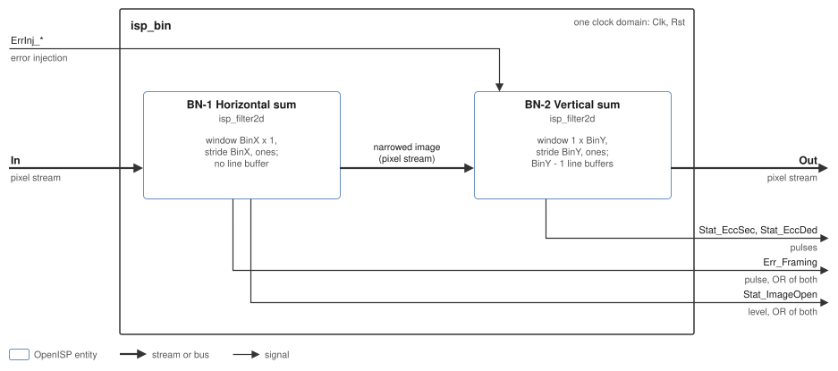

# isp_bin: Architecture

## 1. Block diagram

The module is the connection of two general window filters. The horizontal sum (BN-1) adds `BinX_g` neighbouring
pixels of a line and outputs one pixel for each group: a narrowed image. The vertical sum (BN-2) adds `BinY_g`
lines of that image and outputs one line for each group.

## 2. Building blocks

| ID | Block | Function |
| --- | --- | --- |
| BN-1 | Horizontal sum | [`isp_filter2d`](../../isp_filter2d/docs/architecture.md) with a window of `BinX_g` x 1, anchor 0, stride `BinX_g` along the line and `BinX_g` coefficients of 1. No line buffer. Present for `BinX_g` > 1. |
| BN-2 | Vertical sum | `isp_filter2d` on the image of Wo x H pixels (Wo = `ispBinOut` of `isp_pkg`, PKG-07) with a window of 1 x `BinY_g`, anchor 0, stride `BinY_g` across the lines and `BinY_g` coefficients of 1. `BinY_g` - 1 line buffers of Wo pixels. Present for `BinY_g` > 1. |

With both factors 1 the module consists of an `isp_frame_sync`.

## 3. Ports

| Port | Direction | Width | From |
| --- | --- | --- | --- |
| `Clk`, `Rst` | in | 1 | both |
| `In_Valid`, `In_Ready`, `In_Data`, `In_Last`, `In_User` | | pixel stream, P bits | BN-1 |
| `Out_Valid`, `Out_Ready`, `Out_Data`, `Out_Last`, `Out_User` | | pixel stream, Q bits | BN-2 |
| `Err_Framing`, `Stat_ImageOpen` | out | 1 | OR of both |
| `Stat_EccSec`, `Stat_EccDed` | out | 1 | BN-2 |
| `ErrInj_BitFlip`, `ErrInj_Valid` | in | as `isp_window` of BN-2 | BN-2 |

The AXI4-Lite slaves of the two filters are not connected: with constant coefficients they hold only read-only
registers, and the synthesis tool removes them.

## 4. Connection and widths

The output pixel stream of BN-1 is the input of BN-2. The generics follow the table of the specification
(section 4):

- `OutBits_g` of BN-1 is P + log2ceil(`BinX_g`), `OutBits_g` of BN-2 is Q. Both are the exact widths of the sums of
  ones, so neither limiter ever saturates.
- The border mode goes to both filters. In the border mode valid neither filter generates virtual columns or lines.
- BN-2 has its own frame sync for the narrowed image. BN-1 delivers complete images, so it only acts after an upset
  between the two filters.

With coefficients of 1 the multipliers of the kernels are wires, and each kernel is an adder tree of its factor.

## 5. Timing and throughput

| Property | Value | Requirement |
| --- | --- | --- |
| Pixel rate | One input pixel per clock cycle within a line; BN-1 holds the input for its `BinX_g` - 1 virtual columns after every line (border modes zero and replicate); BN-2 receives one pixel in `BinX_g` cycles | BIN-PF-01 |
| Image period, border mode valid | H x W cycles plus the registers of the two filters | BIN-PF-02 |
| Image period, border modes zero and replicate | H x (W + `BinX_g` - 1) cycles of BN-1, plus the wait for the virtual lines: after every image BN-2 generates (`BinY_g` - 1) x Wo virtual pixels, one per cycle, and its input waits meanwhile; the wait reaches the module input once the buffers of BN-1 are full, at most max(0, (`BinY_g` - 1) x Wo + 2 - 2 x `BinX_g`) cycles (verification plan, section 5) | BIN-PF-01, BIN-PF-02 |
| Latency | log2ceil(`BinX_g`) + 6 clock cycles in BN-1 and log2ceil(`BinY_g`) + 6 in BN-2, after the last pixel of a bin; up to 2 more in each for a pixel that its frame sync took while the filter held its input; with both factors 1 the 2 cycles of the frame sync | |

## 6. Fault tolerance and resources

Both follow from the parts: ECC-protected line buffers in BN-2, flip-flops elsewhere. For 4 x 4 binning of 12-bit
pixels of a line of 4096 pixels: three line buffers of 1024 pixels of 14 bits (43 kbit, 61 kbit with check bits),
two adder trees and about 500 flip-flops; no multiplier.
