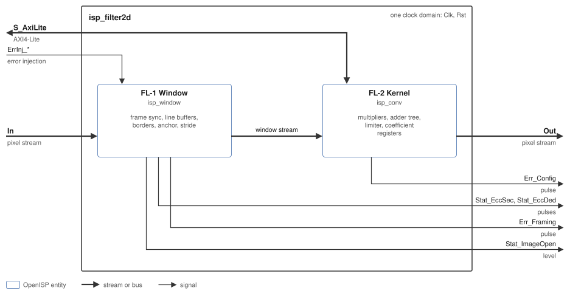

# isp_filter2d: Architecture

## 1. Block diagram

The module is the connection of two entities. The window generator (FL-1) forms the window of every reference pixel;
the kernel (FL-2) reduces every window to one pixel. The window stream between them carries the packets of the
output image, so the output of the kernel is a pixel stream without further logic.

## 2. Building blocks

| ID | Block | Function |
| --- | --- | --- |
| FL-1 | Window | [`isp_window`](../../isp_window/docs/architecture.md): frame sync, line buffers, borders, anchor, stride. |
| FL-2 | Kernel | [`isp_conv`](../../isp_conv/docs/architecture.md): multipliers, adder tree, limiter, coefficient registers on the AXI4-Lite slave. |

## 3. Ports

| Port | Direction | Width | From |
| --- | --- | --- | --- |
| `Clk`, `Rst` | in | 1 | both |
| `In_Valid`, `In_Ready`, `In_Data`, `In_Last`, `In_User` | | pixel stream, `PixelBits_g` | FL-1 |
| `Out_Valid`, `Out_Ready`, `Out_Data`, `Out_Last`, `Out_User` | | pixel stream, B bits | FL-2 |
| `S_AxiLite_*` | | 12 address bits, 32 data bits | FL-2 |
| `Err_Framing`, `Stat_ImageOpen`, `Stat_EccSec`, `Stat_EccDed` | out | 1 | FL-1 |
| `ErrInj_BitFlip`, `ErrInj_Valid` | in | as `isp_window` | FL-1 |
| `Err_Config` | out | 1 | FL-2 |

## 4. Connection

The window stream of FL-1 (`Out_Valid`, `Out_Ready`, `Out_Data`, `Out_Last`, `Out_User`) is the input of FL-2. The
generics `PixelBits_g`, `WinX_g` and `WinY_g` go to both parts, so the widths of the window agree by construction.

The image start that FL-2 uses for its coefficient set is the first window of the output image. Its ready output is
the common enable of its pipeline; the ready path from `Out_Ready` ends at the event control of FL-1 and at the
input stage of the frame sync inside it.

## 5. Timing and throughput

| Property | Value | Requirement |
| --- | --- | --- |
| Pixel rate, image period | Those of FL-1; FL-2 takes one window per clock cycle | FLT-PF-01 |
| Latency | 3 clock cycles in FL-1 and 3 + log2ceil(T) in FL-2: log2ceil(T) + 6 clock cycles | FLT-PF-02 |

## 6. Fault tolerance and resources

Both follow from the parts: ECC-protected line buffers in FL-1, parity-protected coefficient registers in FL-2,
flip-flops elsewhere. The resources are the sum of the two parts (their architecture documents); for a 5 x 5 kernel
on 12-bit pixels of a line of 2048 pixels with run-time coefficients: four line buffers (147 kbit with check bits),
25 multipliers and about 3500 flip-flops.
