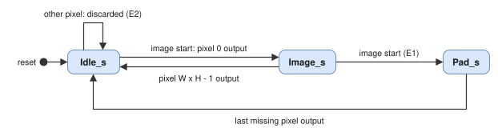

# isp_frame_sync: Architecture

## 1. Block diagram

A pixel passes three blocks. The input stage (FS-1) registers the input handshake and marks the first beat of every
stream packet. The image control (FS-2) decides for every pixel whether it starts an image, belongs to the open
image or belongs to no image, counts the column and the line, and generates the missing pixels of an image that is
too short. The output register (FS-3) holds the pixel with its position and forms the stream packets of the output:
one packet per line with the sequence flags of the line.

## 2. Building blocks

| ID | Block | Function |
| --- | --- | --- |
| FS-1 | Input stage | First-beat flag: set after the reset and after every accepted beat with `In_Last`. `olo_base_pl_stage` (one stage) for pixel, `In_Last`, `In_User` and the first-beat flag: `In_Ready` comes from a register, and the image control sees a pixel before it takes it. |
| FS-2 | Image control | Image state machine (section 5), column counter and line counter, image limits (section 4), detection of E1 to E4, `Err_Framing`, `Stat_ImageOpen`. |
| FS-3 | Output register | `Out_Valid`, `Out_Data`, `Out_Last`, `Out_User`, `Out_PosX`, `Out_PosY` as registers; `Out_Last` and `Out_User` follow from the position (section 6). |

## 3. Ports

| Port | Direction | Width | Description |
| --- | --- | --- | --- |
| `Clk` | in | 1 | Clock |
| `Rst` | in | 1 | Synchronous reset, high-active |
| `In_Valid` | in | 1 | Input stream: valid |
| `In_Ready` | out | 1 | Input stream: ready |
| `In_Data` | in | `PixelBits_g` | Input stream: pixel |
| `In_Last` | in | 1 | Input stream: last beat of a stream packet |
| `In_User` | in | 2 | Input stream: sequence flags of the stream packet |
| `Out_Valid` | out | 1 | Output stream: valid |
| `Out_Ready` | in | 1 | Output stream: ready |
| `Out_Data` | out | `PixelBits_g` | Output stream: pixel |
| `Out_Last` | out | 1 | Output stream: last pixel of a line |
| `Out_User` | out | 2 | Output stream: sequence flags of the line |
| `Out_PosX` | out | max(log2ceil(`ImageWidth_g`), 1) | Column of the pixel |
| `Out_PosY` | out | max(log2ceil(`ImageHeight_g`), 1) | Line of the pixel |
| `Err_Framing` | out | 1 | Pulse: one of the errors E1 to E4 |
| `Stat_ImageOpen` | out | 1 | Level: an image is open |

## 4. Generics and image limits

The generics, defaults and ranges are those of the specification (section 4).

The image size enters the logic in one place only: the pair of limit values `LastX` = `ImageWidth_g` - 1 and `LastY`
= `ImageHeight_g` - 1, with the widths of `Out_PosX` and `Out_PosY`. The counters compare against this pair and
nothing else depends on the generics. Today the pair is a pair of constants.

## 5. Image control (FS-2)

The control looks at the pixel that the input stage offers. A pixel is an image start when its first-beat flag is set
and its sequence flags are "01" or "11".

| State | Offered pixel | Action | Next state |
| --- | --- | --- | --- |
| `Idle_s` | Image start | Taken when the output register is free; output as pixel (0, 0); counters to the next position | `Image_s` (`Idle_s` for an image of one pixel) |
| `Idle_s` | Other pixel | Taken and discarded at once, whatever the output; `Err_Framing` for the first pixel of a run (E2) | `Idle_s` |
| `Image_s` | Pixel that is not an image start | Taken when the output register is free; output with the position of the counters; counters to the next position. Check E3 with the last pixel, E4 with `In_Last` and the sequence flags "10" or "11" before it | `Idle_s` after the last pixel, else `Image_s` |
| `Image_s` | Image start | Not taken: it waits in the input stage; `Err_Framing` (E1) | `Pad_s` |
| `Pad_s` | Any | Not taken. One missing pixel of value 0 per cycle into the free output register, with the position of the counters | `Idle_s` after the last pixel |

The position advances in the same way in `Image_s` and `Pad_s`: the column counter counts to `LastX` and returns
to 0, the line counter counts with every return. The last pixel of an image is the one with column >= `LastX` and
line >= `LastY`; the comparisons are "greater or equal", so a counter that an upset moved beyond its limit ends the
line or the image at once.

`Stat_ImageOpen` is high in `Image_s` and `Pad_s`. After `Pad_s` the waiting image start is taken in `Idle_s` like any
other.

### Recovery

The reset and the `when others` branch of the state machine lead to `Idle_s`. Every image start that is taken sets
both counters. An upset of the state or of a counter therefore changes the positions or the length of the image in
progress, and at the latest the next image start restores the alignment (FSY-FT-01).

## 6. Output register (FS-3)

The output register is loaded with a pixel from the input stage (`Idle_s`, `Image_s`) or with a missing pixel
(`Pad_s`) when it is empty or its beat transfers in the same cycle. The packet signals are functions of the position
of the pixel:

| Signal | Value |
| --- | --- |
| `Out_Last` | Column >= `LastX` |
| `Out_User` | "11" in line 0 when `LastY` = 0; "01" in line 0; "10" in line >= `LastY`; "00" otherwise |
| `Out_PosX`, `Out_PosY` | Column and line counters at the time the pixel was taken |

The output never depends on `In_Last` or `In_User` of the pixel, only on its position.

## 7. Timing and throughput

| Property | Value | Requirement |
| --- | --- | --- |
| Pixel rate | One pixel per clock cycle: the input stage and the output register each transfer in every cycle while `In_Valid` and `Out_Ready` are high, also across lines and images | FSY-PF-01 |
| Latency | 2 clock cycles from the acceptance at the input to `Out_Valid`: one for the input stage, one for the output register | FSY-PF-02 |
| Missing pixels | An image start reaches the control one cycle after the input took it; the control enters `Pad_s` in the next cycle and loads the m missing pixels into the output register in m cycles; it takes the image start in the cycle after, which puts it at the output m + 3 cycles after the input took it | FSY-PF-03 |
| Discarded pixels | One per clock cycle in `Idle_s`, independent of `Out_Ready` | FSY-PF-04 |

Paths: `Out_Ready` reaches the enable of the output register, the counters and the ready input of the input stage
through one logic level. `In_Ready` is a register of the input stage, so no combinational path runs from the output
to the input of the module. The longest path is the counter increment with the comparison against the limits, 16 bits
at most.

## 8. Fault tolerance

The module has no memory. Its registers (input stage, state, counters, output register) are flip-flops without
protection of their own: an upset disturbs at most the image in progress (section 5, Recovery). Triple modular
redundancy of the flip-flops is a choice of the integrator in the synthesis tool.

## 9. Resource estimate

About 2 x (`PixelBits_g` + 4) flip-flops for the input stage, `PixelBits_g` + 4 + the two position widths for the
output register, the two counters and a few state bits: about 110 flip-flops and 80 LUTs for 12-bit pixels and
images up to 4096 x 4096. Synthesis results replace this estimate in the verification report.
